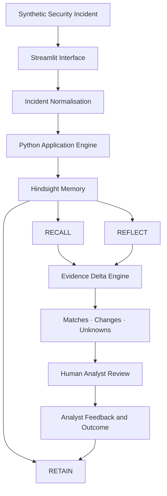

# AFTERTRACE

### Remember the incident. Re-check the evidence. Never inherit the conclusion.

<p align="center">
  <strong>A memory-driven incident-continuity assistant for security operations.</strong>
</p>

<p align="center">
  <a href="https://aftertrace-exordium.streamlit.app/"><strong>🚀 Live Demo</strong></a>
  ·
  <a href="https://github.com/The-Omega-MAD/Aftertrace"><strong>GitHub Repository</strong></a>
  ·
  <a href="https://hindsight.vectorize.io/"><strong>Hindsight Documentation</strong></a>
</p>

---

## The idea

**What if an AI incident-response assistant remembered the investigation, but refused to inherit its conclusion?**

Security teams repeatedly encounter alerts that resemble incidents they have investigated before. Historical context can save time, but blindly reusing an earlier verdict can introduce dangerous assumptions.

AFTERTRACE addresses this problem with persistent memory powered by **[Hindsight](https://github.com/vectorize-io/hindsight)**.

It retains investigation findings and analyst feedback, recalls relevant history when a new incident arrives, and compares historical context against current evidence.

Its defining feature is the **Evidence Delta**: a structured explanation of what matches, what changed, and what remains unknown.

> Past incidents are context. They are not verdicts.

## See AFTERTRACE in action

<https://aftertrace-exordium.streamlit.app/>

The application is deployed publicly on Streamlit Community Cloud. It uses synthetic identity-security incidents to demonstrate its workflow.

## The problem: familiar does not mean identical

Imagine an analyst investigating an OAuth application alert.

The application appeared in an earlier investigation and was verified as an approved integration in that specific case.

Later, another alert arrives involving the same application.

This time, a new permission change is observed, and the actor behind it is unverified.

A system without memory starts from scratch. A system that remembers carelessly might repeat the previous benign conclusion.

Neither is good enough.

AFTERTRACE retrieves the previous investigation while keeping the new evidence separate.

### The Evidence Delta

| Dimension | Previous investigation | New investigation |
|---|---|---|
| Application | Northstar Calendar Connector | Same application |
| Approval context | Verified in that case | Must be independently verified |
| Permission event | No new grant recorded | New permission change observed |
| Actor context | Previously reviewed | Unverified |
| Outcome | Resolved after review | Undetermined |

AFTERTRACE identifies the historical connection without treating it as proof of current authorization.

The analyst is prompted to verify the permission change, actor identity, authorization, and business justification.

**The important distinction:** remembering an approved application is useful. Assuming every future action by that application is approved is not.

## How it works

AFTERTRACE follows one focused incident-continuity workflow:

1. **Capture:** An analyst submits a structured security incident.
2. **Retain:** Investigation observations and findings are stored in Hindsight.
3. **Recall:** A related incident triggers retrieval of relevant historical context.
4. **Reflect:** Hindsight synthesizes the recalled information for the current investigation.
5. **Compare:** The Evidence Delta highlights matches, changed evidence, and unknowns.
6. **Review:** The analyst evaluates the findings and provides feedback.
7. **Learn:** Analyst feedback and the final outcome are retained for future investigations.

### Why Hindsight matters

Hindsight is not an optional chatbot integration. It is the persistent memory layer that makes incident continuity possible.

| Hindsight capability | How AFTERTRACE uses it |
|---|---|
| **Retain** | Stores investigation details, analyst findings, lessons, and outcomes. |
| **Recall** | Retrieves relevant historical investigations for a new incident. |
| **Reflect** | Synthesizes recalled history into useful context for the current investigation. |

The memory loop changes the system's behavior across investigations:

- **Before memory:** The assistant has no previous investigation to reference.
- **After the first investigation:** Historical observations and analyst feedback are retained.
- **During a related investigation:** Relevant context is recalled rather than reconstructed manually.
- **When evidence changes:** The Evidence Delta highlights differences instead of repeating the old conclusion.
- **After analyst review:** New findings become context for subsequent investigations.

This is the difference between a chatbot that answers one alert and an assistant that can carry investigation knowledge forward.

## Architecture



### Technology stack

| Layer | Technology | Purpose |
|---|---|---|
| Interface | Streamlit | Incident intake, investigation workspace, memory trail, and analyst feedback |
| Application | Python | Incident validation, orchestration, and evidence comparison |
| Persistent memory | Hindsight | Retain, recall, and reflect across investigations |
| SDK | `hindsight-client` | Python integration with Hindsight |
| Demo data | Synthetic JSON | Repeatable identity-security incident scenarios |
| Testing | Python `unittest` | Engine and application behavior tests |

## A closer look

### 1. Incident investigation

AFTERTRACE provides a structured workspace for reviewing synthetic security alerts and their associated observations.

### 2. Historical memory

The memory trail makes previously retained investigation context visible instead of hiding memory behind a generic chat response.

### 3. Evidence comparison

The Evidence Delta separates historical similarities from newly observed facts and unresolved questions.

### 4. Analyst feedback

Analysts can record their findings, lessons, and final disposition. That feedback becomes part of the memory used in future investigations.

### 5. Band AI Desktop

Band AI Desktop was used during development to inspect the repository, implement improvements, and verify the application. Screenshots documenting the workflow are available in [`docs/BAND Desktop usage/`](docs/BAND%20Desktop%20usage/).

Dashboard screenshots are available in [`docs/Dashboard Screenshots/`](docs/Dashboard%20Screenshots/).

## Running locally

### Requirements

- Python 3.10 or later
- A Hindsight Cloud account/API key or reachable Hindsight deployment
- A configured LLM provider in Hindsight for Reflect

### 1. Clone the repository

```bash
git clone https://github.com/The-Omega-MAD/Aftertrace.git
cd Aftertrace
```

### 2. Create a virtual environment

**Windows PowerShell**

```powershell
python -m venv .venv
.\.venv\Scripts\Activate.ps1
```

**Linux / macOS**

```bash
python -m venv .venv
source .venv/bin/activate
```

### 3. Install dependencies

```bash
pip install -r requirements.txt
```

### 4. Configure Hindsight

Create a `.env` file in the repository root:

```env
HINDSIGHT_API_KEY=your_api_key
HINDSIGHT_BASE_URL=https://api.hindsight.vectorize.io
HINDSIGHT_BANK_ID=aftertrace-exordium
```

Never commit `.env` or expose API keys in source code, screenshots, or public repositories.

### 5. Start the application

```bash
streamlit run app.py
```

Open the local URL displayed by Streamlit, usually:

```text
http://localhost:8501
```

## Deploying with Streamlit Community Cloud

AFTERTRACE is deployed using Streamlit Community Cloud.

To deploy your own instance:

1. Fork this repository.
2. Sign in to [Streamlit Community Cloud](https://share.streamlit.io/).
3. Create an app using your repository.
4. Select the `main` branch and `app.py` as the main file.
5. Add the Hindsight environment variables through the app's Secrets settings.
6. Deploy.

Keep credentials in deployment secrets, never in the GitHub repository.

## Project structure

```text
Aftertrace/
├── app.py
├── aftertrace/
│   ├── __init__.py
│   ├── engine.py
│   ├── incidents.py
│   ├── ui_state.py
│   └── sample_data.py
├── data/
│   └── sample_incidents.json
├── docs/
│   ├── ARCHITECTURE.md
│   ├── DEMO_SCRIPT.md
│   ├── CONTENT_CHECKLIST.md
│   ├── ARTICLE.md
│   ├── LINKEDIN_POST.md
│   ├── VIDEO_SCRIPT.md
│   ├── BAND Desktop usage/
│   └── Dashboard Screenshots/
├── tests/
│   └── test_engine.py
├── .env.example
├── .gitignore
└── requirements.txt
```

## Testing

Run the test suite:

```bash
python -m unittest discover -s tests -v
```

The repository includes tests for incident processing and application behavior.

## Trust boundaries

AFTERTRACE is an investigation-support prototype, not an autonomous security-response system.

- All included incident scenarios use synthetic data.
- It does not connect to or modify production systems.
- It does not execute containment or remediation actions.
- It does not automatically close, suppress, or declare alerts benign.
- Historical context is kept distinct from current observations.
- Missing evidence is surfaced rather than silently assumed.
- A human analyst retains responsibility for the final decision.

**Memory should improve investigation quality, not replace investigation judgment.**

## What makes AFTERTRACE different?

| Common approach | AFTERTRACE |
|---|---|
| Treats each alert as an isolated interaction | Carries investigation context across incidents |
| Summarizes the current alert | Compares current evidence with historical findings |
| Repeats previous answers | Identifies what has changed |
| Treats historical conclusions as reusable answers | Preserves the distinction between context and verdict |
| Leaves corrections in disconnected notes | Retains analyst feedback for future investigations |

## Judging criteria and project evidence

| Criterion | Weight | Evidence in AFTERTRACE |
|---|---:|---|
| Innovation | 30% | Evidence Delta and explicit historical-versus-current evidence comparison |
| Hindsight Memory | 25% | Retain → Recall → Reflect, followed by analyst-feedback retention |
| Technical Implementation | 20% | Modular Python codebase, Hindsight SDK integration, validation, and tests |
| User Experience | 15% | Focused investigation workflow, visible memory trail, and structured comparison |
| Real-world Impact | 10% | Preserving investigation knowledge and reducing repeated context reconstruction |

## Team EXORDIUM

- **Michael Abhishek Duggi**
- **Shreyas Uppin**
- **Velishala Sai Charan Teja**

---

<p align="center">
  <strong>AFTERTRACE</strong>
  <br/>
  Past incidents are context. They are not verdicts.
  <br/><br/>
  <a href="https://aftertrace-exordium.streamlit.app/">Explore the live application</a>
  ·
  <a href="https://github.com/The-Omega-MAD/Aftertrace">View the source code</a>
</p>

**Built with Python, Streamlit, and Hindsight.**

