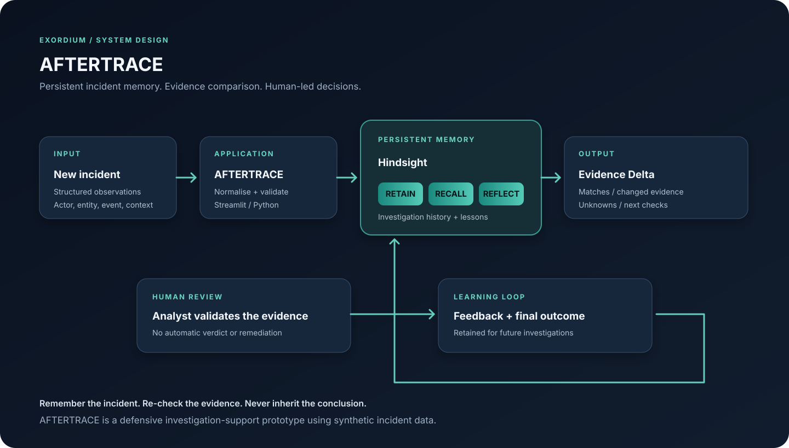

# I Used Hindsight to Stop Reusing Old Incident Conclusions

A familiar security alert can be more dangerous than a completely new one. The team recognises the application, remembers that it was approved last week, and is tempted to treat the new event as already understood. But the new event may contain one permission change that was never present in the old investigation.

That is the problem I wanted to explore with AFTERTRACE: an incident-continuity assistant that remembers what a team learned without assuming that the next incident has the same explanation.

## The problem is not a lack of summaries

Security teams accumulate knowledge in incident tickets, analyst notes, handovers, and post-incident reviews. A new analyst may see a familiar application and still have to search through that history to understand what happened before.

A generic chatbot can summarise the current alert. A retrieval system can return old notes. Neither alone guarantees that the new evidence is compared carefully with the historical record.

The failure mode I care about is **conclusion inheritance**: a previous investigation was benign, so a later alert involving the same entity is treated as benign too. Similarity is useful context, not proof.

## What AFTERTRACE does

AFTERTRACE focuses on one workflow. It accepts a structured incident, retrieves relevant investigation history, compares current fields with the historical record, and gives the analyst a grounded explanation of what matches, what changed, and what remains unknown.

The key interface concept is the Evidence Delta. In the current implementation, it compares four visible fields: the application or entity, actor context, permission event, and approval context. That comparison is deterministic. Hindsight supplies the memory and the contextual reasoning around it.

I deliberately kept those responsibilities separate. A model-generated paragraph should not be presented as though it were a verified field-by-field diff.



## Why Hindsight is the centre of the design

I used Hindsight because the product needs continuity across separate investigations. The integration is built around three operations.

First, `retain_incident()` serialises the investigation and stores it in a Hindsight memory bank. The retained content includes incident observations, analyst findings, lessons, and outcomes. Metadata identifies the project, incident ID, synthetic status, and record type.

Second, `recall_incidents()` searches for previous investigations relevant to the current alert. The query includes the new incident facts and explicitly asks for both similarities and warnings against reusing an old disposition.

Third, `reflect_on_incident()` asks Hindsight to reason over the current event and relevant history. The prompt requests separate sections for historical context, matches, evidence delta, unknowns, next checks, and caution.

The separation between recall and reflect matters. Recall gives the application retrieved memory records that can be shown in the interface. Reflect produces a synthesised answer. The analyst can inspect both rather than receiving an unexplained conclusion.

## The implementation

The Hindsight client is initialised from environment variables so credentials are not hard-coded:

```python
from hindsight_client import Hindsight

client = Hindsight(
    base_url=os.getenv("HINDSIGHT_BASE_URL"),
    api_key=os.getenv("HINDSIGHT_API_KEY"),
)
```

The retain path stores the incident as structured JSON with context and metadata:

```python
client.retain(
    bank_id=bank_id,
    content=incident_memory_text(incident),
    context="AFTERTRACE incident investigation and analyst learning",
    metadata={
        "project": "AFTERTRACE",
        "incident_id": incident.get("incident_id", "unknown"),
        "synthetic": True,
        "record_type": "incident_investigation",
    },
    timestamp=incident.get("timestamp"),
)
```

For a new event, the application calls recall and then reflect:

```python
result = client.recall(
    bank_id=bank_id,
    query=query,
    budget="mid",
)

response = client.reflect(
    bank_id=bank_id,
    query=reflection_prompt,
    budget="mid",
)
```

The exact response quality depends on the Hindsight deployment and its configured language model. That is an operational dependency, not something the interface should hide.

## A concrete before-and-after

The synthetic first incident concerns an OAuth application called Northstar Calendar Connector. In that investigation, the application is verified as an approved integration and no new permission grant is recorded. The analyst retains an important qualification: approval in one investigation does not establish that future permission changes are safe.

The follow-up incident concerns the same application. This time, a new permission change is observed and the actor context has not been verified.

Without memory, an assistant sees only the current alert. With Hindsight, AFTERTRACE can recall the earlier approval and, crucially, the earlier caution. The Evidence Delta then makes the changed permission event visible.

The appropriate response is not “this is benign because we saw it before.” It is “we have seen this application before, but this event is materially different; verify the permission grant, actor, and business justification.”

That is a narrower claim, and a more useful one.

## What I learned and what is still limited

The first lesson is that memory needs a job. “Remember everything” is not a product requirement. AFTERTRACE retains incident facts and analyst lessons because those are the pieces needed for the next investigation.

The second lesson is that provenance matters. Showing recalled memory separately from current observations makes it easier for an analyst to challenge stale or irrelevant context.

The third lesson is that a comparison should not be delegated entirely to free-form generation. The initial Evidence Delta uses explicit structured fields, while Hindsight provides contextual recall and reflection.

There are limitations. The current scenario uses synthetic identity-security incidents. The field comparison is intentionally small, and the quality of reflection depends on the configured Hindsight language model. The prototype does not ingest a live SIEM stream, validate identity-provider telemetry, or execute response actions. Those are not capabilities I claim it has.

## The principle

AFTERTRACE is built around a simple rule: remember the investigation, not just the verdict.

Hindsight makes it possible to carry useful context from one investigation into another. The Evidence Delta makes the change visible. The analyst remains responsible for deciding what the evidence means.

Useful agent memory should make the next decision better informed, not make it automatic.

Learn more: [Hindsight on GitHub](https://github.com/vectorize-io/hindsight), the [Hindsight documentation](https://hindsight.vectorize.io/), and [Vectorize's explanation of agent memory](https://vectorize.io/what-is-agent-memory).
